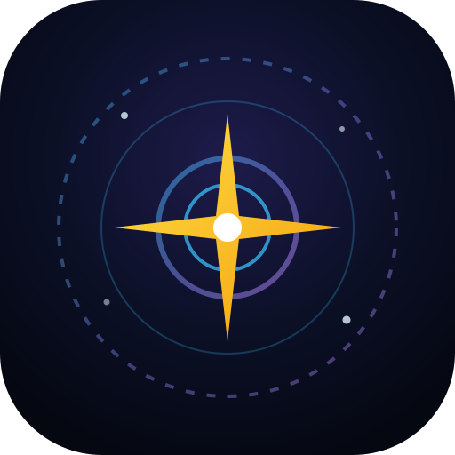

<div align="center">



# 🔭 AstroSee — Seeing & Meteo Astronomico

**Progressive Web App (PWA) Mobile-First per il monitoraggio del Seeing Astronomico, Trasparenza Atmosferica e Previsioni 7Timer! con AI Observing Advisor.**

[](#architettura-offline--pwa)
[](#integrazione-7timer--motore-dati)
[](#funzionalit%C3%A0-principali)
[](#licenza)

</div>

---

## ✨ Panoramica

**AstroSee** è una Web App progettata per astrofili, astrofotografi e osservatori visuali che necessitano di valutare rapidamente la qualità della colonna d'aria prima e durante una sessione osservativa.

L'interfaccia adotta un design **Deep Space Glassmorphism** nativamente scuro per non affaticare la vista e integra una **Modalità Visione Notturna Rossa** (`Red Night-Vision Mode`) che abbatte le lunghezze d'onda blu/verdi, preservando l'adattamento scotopico della pupilla sotto cieli bui.

---

## 🚀 Funzionalità Principali

### 📍 1. Triplo Sistema di Input della Posizione
* **Geolocalizzazione GPS Nativa:** Acquisizione immediata delle coordinate tramite `navigator.geolocation` ad alta precisione.
* **Mappa Interattiva Dark-Mode (Leaflet.js):** Selezione libera del sito osservativo toccando la mappa o trascinando il pin luminoso, con *reverse-geocoding* automatico della località (ideale per passi alpini o zone remote).
* **Ricerca Geocoding (Nominatim / OpenStreetMap):** Barra di ricerca con menu a tendina autocomplete per città, montagne e osservatori, affiancata da *chip rapidi* preconfigurati (*Osservatorio di Asiago*, *Campo Imperatore - Gran Sasso*, *Monte Etna*, *Roque de los Muchachos - La Palma*).

### ⏱️ 2. Finestra Temporale Flessibile
* **Filtri Rapidi:** *Stasera / Notte (18:00–06:00)*, *Prossime 24h*, *48 Ore*, *72 Ore (3 giorni)*.
* **Slider Orizzonte Continuo:** Regolazione granulare da `+6h` a `+72h` a step di 3 ore.
* **Filtro "Solo Fasce Notturne":** Esclude automaticamente le ore diurne per concentrare l'analisi e i grafici sulle sole ore crepuscolari e notturne.

### 🤖 3. AI Observing Advisor
Un motore di sintesi intelligente analizza i blocchi previsionali nell'intervallo selezionato ed elabora:
* **La Finestra Osservativa Migliore:** Individua i blocchi contigui con il miglior compromesso tra assenza di nubi, seeing laminare e trasparenza.
* **Target Astronomici Consigliati:** Suggerisce automaticamente cosa osservare/fotografare in base al rapporto tra Seeing e Trasparenza (es. *Alta Risoluzione Planetaria e Stelle Doppie* con seeing in classe 1–2, oppure *Deep-Sky a Banda Larga / Filtri H-Alpha* con trasparenza cristallina).
* **Avvisi e Criticità Atmosferiche:** Segnala raffiche di vento al suolo (rischio micro-vibrazioni sulla montatura), passaggi di velature, instabilità convettiva (*Lifted Index* negativo) e rischio di condensa/appannamento delle ottiche quando l'umidità relativa supera l'80%.

### 📊 4. Telemetria, Semafori e Grafico Interattivo
* **Indice di Qualità Osservativa (0–100):** Algoritmo composito che pesa copertura nuvolosa, seeing, trasparenza, vento e stabilità termodinamica, restituendo un badge semaforico immediato (**Verde = Ottimo**, **Giallo = Discreto**, **Rosso = Critico**).
* **Curva di Qualità Interattiva:** Grafico a barre colorate cliccabili per scorrere istantaneamente alla card di dettaglio dello slot orario desiderato.

---

## 📡 Integrazione 7Timer! & Motore Dati

L'applicazione decodifica tutti i parametri scientifici del prodotto **`astro`** di **7Timer!**:

| Parametro | Scala 7Timer! | Decodifica & Soglie Semaforiche in AstroSee |
| :--- | :---: | :--- |
| **`seeing`** | `1` – `8` | Turbolenza in secondi d'arco: **1–3 Ottimo/Buono** (`<0.5"` – `1.0"`), **4–5 Discreto** (`1.0"` – `1.5"`), **6–8 Scarso/Pessimo** (`>1.5"`). |
| **`transparency`** | `1` – `8` | Estinzione atmosferica zenitale (mag/airmass): **1–3 Cristallina/Buona** (`<0.5`), **4–5 Discreta/Foschia** (`0.5–0.7`), **6–8 Velata/Opaca** (`>0.7`). |
| **`cloudcover`** | `1` – `9` | Copertura nuvolosa: **1–2 Sereno** (`0–19%`), **3–5 Poco/Parz. Nuvoloso** (`19–56%`), **6–9 Molto Nuvoloso/Coperto** (`56–100%`). |
| **`lifted_index`** | `-10` a `+15` | Stabilità termodinamica: **`>= +2` Stabile** (aria stratificata), **`-1` Neutro**, **`<= -4` Instabile** (moti convettivi/turbolenza). |
| **`wind10m`** | `1` – `8` + Dir | Velocità del vento a 10m: **1–2 Calma/Brezza** (`<3.4 m/s`), **3 Moderato** (`3.4–8.0 m/s`), **4–8 Sostenuto/Forte** (`>8.0 m/s`). |

### Architettura di Fetch Resiliente (Anti-CORS & Offline)
Poiché i server pubblici di `7timer.info` non espongono sempre l'header `Access-Control-Allow-Origin: *` per le richieste dirette dal browser, **AstroSee** implementa una strategia a cascata a 4 livelli:
1. **Proxy Locale (`/api/7timer`)**: se avviata tramite `node server.js`, interroga direttamente 7Timer! lato server aggirando ogni blocco CORS.
2. **Chiamata Diretta 7Timer!**: tentativo diretto verso `https://www.7timer.info/bin/api.pl`.
3. **Telemetria Live GFS/IFS (CORS-friendly)**: se aperta come pagina statica (es. GitHub Pages) e il browser blocca 7Timer! per CORS, interroga in tempo reale le API meteorologiche GFS/IFS per le coordinate scelte e converte i parametri fisici nelle esatte classi `1–8` / `1–9` di 7Timer!.
4. **Cache Offline (`Service Worker` + `localStorage`)**: in assenza totale di rete (es. siti montani senza copertura cellulare), ripristina automaticamente l'ultima previsione scaricata.

---

## 🛠️ Stack Tecnologico & Struttura del Progetto

Nessun framework pesante o step di build richiesto: puro **HTML5**, **CSS3 Custom Properties** e **Vanilla JavaScript (ES6+)**.

```text
Seeing_App/
├── index.html       # Struttura semantica Mobile-First e interfaccia utente
├── style.css        # Design System Deep Space Glassmorphism + Red Night-Vision Mode
├── app.js           # Logica applicativa, decodifica 7Timer!, mappa Leaflet e AI Advisor
├── sw.js            # Service Worker per caching asset statici e previsioni offline
├── server.js        # Server HTTP Node.js opzionale con proxy CORS nativo per 7Timer!
├── manifest.json    # Web App Manifest per installazione PWA su iOS / Android / Desktop
├── icon.svg         # Icona vettoriale astronomica (Disco di Airy & Stella)
└── README.md        # Documentazione del progetto
```

---

## ⚡ Installazione e Avvio Rapido

### Opzione 1: Avvio con Server Node.js + Proxy 7Timer! (Consigliato in locale)
Se hai [Node.js](https://nodejs.org/) installato, puoi avviare il server integrato (zero dipendenze `npm` richieste):

```bash
git clone https://github.com/TUO-USERNAME/Seeing_App.git
cd Seeing_App
node server.js
```
Apri il browser su **`http://localhost:8080`**.

### Opzione 2: Qualsiasi Server Statico o GitHub Pages
Puoi servire la cartella con qualsiasi web server statico (Python, VS Code Live Server, `npx serve`) oppure pubblicarla direttamente su **GitHub Pages**:

```bash
# Con Python 3
python -m http.server 8080

# Oppure con npx
npx serve .
```

---

## 📲 Installazione come App (PWA) su Smartphone
1. Apri l'URL dell'app (su GitHub Pages o rete locale) da **Chrome** (Android) o **Safari** (iOS).
2. Tocca il menu del browser e seleziona **"Aggiungi alla schermata Home"** / **"Installa applicazione"**.
3. L'app si aprirà a tutto schermo (`standalone`) e manterrà in cache l'ultima previsione scaricata anche quando ti sposterai in zone prive di segnale dati.

---

## 📄 Licenza

Distribuito sotto licenza **MIT**. Sentiti libero di usare, modificare e condividere questo progetto. *Cieli sereni!* ✨
